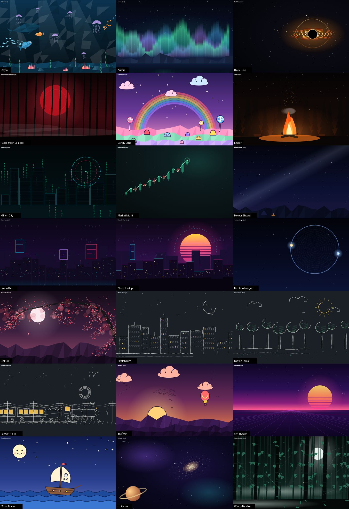
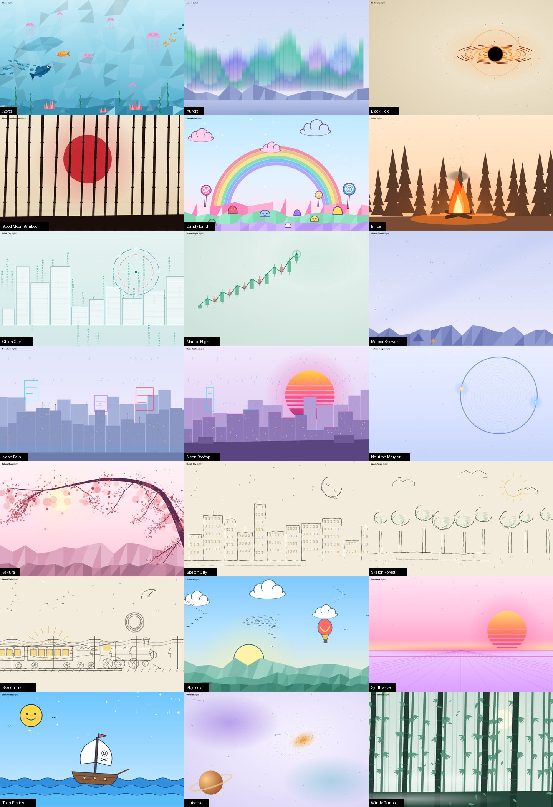

# Dola Themes

[**Dola AI**](https://dolaai.pro): free AI tools and Claude add-ons




26 animated looks for the Claude desktop app's Code tab. Every scene comes in a **dark** and a **light** version, is drawn as one lightweight SVG with CSS animation (no scripts, no downloads), and switches with a single command.

## Install

**Plugin marketplace (recommended)**

```
/plugin marketplace add Dola-AI/dola-themes
/plugin install dola-themes@dola-themes
```

In the desktop app, where `/plugin` does not run: click **+** next to the prompt box, choose **Plugins**, **Add marketplace** with `Dola-AI/dola-themes`, then **Add plugin**.

**Clone**

```
git clone https://github.com/Dola-AI/dola-themes ~/.claude/skills/dola-themes
```

**Manual**: or copy this folder to `~/.claude/skills/dola-themes` (on Windows `%USERPROFILE%\.claude\skills\dola-themes`).

Start a **new session** after installing, then type `/themes`.

## Use

```
/themes                  list every theme, grouped (the current one is marked)
/dola-aurora             switch to a theme: /dola-<name>
/dola-aurora light       switch theme and mode together
/dola-mode               flip light / dark for the current theme
/themes off              back to the app's own look
```

Your pick and mode are remembered for every new session. Shortcuts: `/dola-train`, `/dola-bamboo`, `/dola-sketch`, `/dola-blackhole`, `/dola-cyberpunk`, `/dola-discord`, `/dola-telegram`, `/dola-x`, `/dola-facebook`, `/dola-instagram` (and `/dola-twitter`, `/dola-fb`, `/dola-ig`, `/dola-tg`).

## Themes

| Group | Theme | Look |
|-------|-------|------|
| Cyberpunk & neon | **Neon Rooftop** | Rainy rooftop under a striped neon sun |
| | **Neon Rain** | Megacity in the rain, flickering signs |
| | **Glitch City** | Code rain, wireframe skyline, targeting ring, glitch tears |
| | **Synthwave** | Striped sun and a grid rushing at you |
| | **Market Night** | Teal trading desk with a self-drawing candlestick chart |
| Ink & cartoon | **Windy Bamboo** | Moonlit bamboo forest in a gale, stalks bending with every gust |
| | **Blood Moon Bamboo** | Red moon over windswept bamboo |
| | **Toon Pirates** | Smiling moon, rocking pirate ship, gulls |
| | **Candy Land** | Rainbow, lollipops, gumdrops, bouncing jellies |
| | **Skyflock** | V-formation flocks and a swirling murmuration |
| Cosmos | **Black Hole** | Accretion disk, bent light, infalling matter |
| | **Neutron Merger** | Two neutron stars spiral in, gravitational waves, kilonova flash |
| | **Meteor Shower** | Milky Way and meteors over a ridge |
| | **Universe** | Spiral galaxy, nebulae, ringed planet, comets |
| Sketchbook | **Sketch Forest** | Forest drawn stroke by stroke in chalk or pencil |
| | **Sketch City** | Skyline sketched under a pencilled moon |
| | **Sketch Train** | Steam-train journey: chalk at night, sunrise in the morning |
| Calm & nature | **Abyss** | Low-poly ocean: kelp, coral, schools of fish, a whale, jellyfish |
| | **Aurora** | Rippling curtains of light over snowy peaks and a mirror lake |
| | **Sakura Dusk** | Moon, blossoming limb, falling petals |
| | **Ember** | Campfire among pines: flames, sparks, smoke |
| App colors | **Blurple** (Discord-style) | Graphite and blurple, dark |
| | **Sky Chat** (Telegram-style) | Airy blue, light and dark |
| | **Lights Out** (X-style) | Pure black with a bright blue accent, dark |
| | **Social Blue** (Facebook-style) | Friendly blue, light and dark |
| | **Gradient Pop** (Instagram-style) | Clean neutrals with a magenta accent, light and dark |

The app-color themes change colors only, no backdrop, and use no logos or artwork. All scenes are original artwork.

Open `previews/<theme>-dark.html` or `previews/<theme>-light.html` in a browser to watch any scene animate.

## Settings

Open `/config` and find **dola-themes**:

- **Animation speed**: calm, normal or lively.
- **Frosted glass**: how the scene is dimmed behind the text: clear (sharp but dimmed, the default), off, light, strong, or default (the app's own blur).
- **Start mode**: light or dark, until you pick one with `/dola-mode`.

## Privacy and what it does

- Registers the slash commands `/themes`, `/dola-mode` and one `/dola-<name>` per theme.
- Stores only your chosen theme and mode (in the plugin's own store).
- Draws the theme through the app's theme and backdrop APIs. It reads no files, makes no network calls, runs no scripts and sends no data anywhere.

### For reviewers

- `hooks/make-colors.js` is generated from the app's color system. Its long hex string (line 607) is a table of gray steps used to build palettes, not an encoded payload. "token" in that file means a design token (a named color), never a credential.
- The plugin reads only its own stored theme and mode (`store.get`). Nothing it reads is sent anywhere.
- `$.theme.set` / `$.theme.clear` are the desktop app's theming calls.
- Command names are built from the fixed prefix `dola` plus a theme id from a built-in list.

## Notes

- Themes draw in the desktop and mobile apps. The terminal draws no themes.
- Every scene stops moving when the OS asks for reduced motion.
- Each scene is a single SVG under 130 KB.
- A theme recolors the whole Code tab, sidebar included. It can't change layout, icons or fonts.

## Develop and test

```
claude plugin validate .
claude plugin test .
```

To add a theme: add a file in `hooks/themes/` (copy an existing one), then add it to a group in `hooks/themes/index.ts`. Palette contrast is checked when the theme loads.

## License

MIT, see [LICENSE](LICENSE). Made by [Dola AI](https://dolaai.pro).
